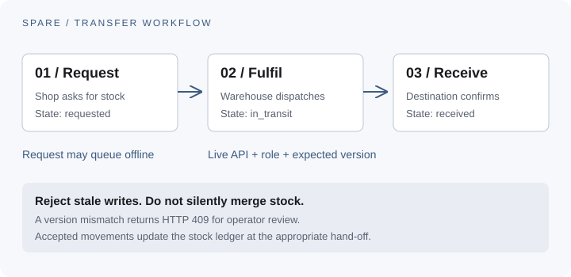

# Spare Parts Operations Platform (SPOP)

An offline-first Progressive Web App (PWA) operational ERP for automotive
spare parts SMEs (1 warehouse + N retail shops). Not a POS — tracks
inventory movement, transfers, sales recording, purchasing, approvals,
accounting, and audit trails.

**Status: Phases 1–11 complete; private pilot launched on Sites.** Phase 10 ships a heuristic v1 (trailing
sales velocity, not machine learning) rather than real demand forecasting
— see `PHASED_PLAN.md` for why that stays deferred until there's real
production data to validate a model against.

## My contribution

I built the inventory, purchasing, sales, approval, accounting, and audit
workflows across the API and offline-capable web interface. The public source
includes the self-hosted implementation and its tests; private pilot data and
the hosted pilot deployment code are excluded.

## Transfer workflow at a glance



The diagram shows the stock transfer hand-offs and where the API checks
permissions and record versions. It is a workflow illustration, not a pilot
screen capture.

## Current MVP

- **Phase 1 — Identity, RBAC, Branches**: six fixed roles (Owner,
  Accountant, Store Keeper, Shop Manager, Cashier, Super Admin), bcrypt
  password hashing with transparent legacy-hash upgrade, JWT access +
  rotating refresh tokens, per-device registration, role-gated admin
  screens for users and branches.
- **Phase 2 — Inventory Engine**: product categories (self-referential),
  append-only stock ledger as the single source of truth, and a two-step
  branch transfer workflow (`requested → in_transit → received`, plus
  cancel) instead of an instant one-shot move.
- **Phase 3 — Offline Sync**: every device-authored table carries
  `id/device_id/created_by_id/created_at/updated_at/version/sync_status`;
  optimistic-concurrency conflict detection (`expected_version` → `409`)
  on transfer fulfil/receive and purchase-order receive; idempotency keys
  on every create endpoint; a real Dexie-backed offline cache/outbox and a
  real Workbox (`injectManifest`) service worker.
- **Phase 4 — Sales Recording**: customer records (optional on a sale,
  walk-ins stay valid), a daily-sales report view.
- **Phase 5 — Purchasing**: purchase orders flow
  `requested → approved → received`, with per-line idempotent receiving.
- **Phase 6 — Approval Engine**: approvals carry a deadline and lazily
  escalate priority when overdue; expense and purchase-order approvals are
  auto-created and resolved through one shared dispatch path so the
  approval and the record it gates can never drift out of sync; gated
  product price changes.
- **Phase 7 — Notifications**: pluggable notification channels (console
  email by default, SMTP and Firebase Cloud Messaging when configured),
  low-stock alerts fired only on the movement that crosses the reorder
  threshold, and a sync-failure reporting endpoint for the offline outbox.
- **Phase 8 — Accounting**: supplier payments (optionally linked to a
  purchase order) and an append-only `journal_entries` ledger — the same
  never-a-mutable-balance discipline as stock — posted automatically from
  sale, expense approval, purchase-order receive, and supplier payment.
- **Phase 9 — Reports & Analytics**: accrual-basis profit & loss,
  per-branch performance (sales, stock value, low-stock count), expenses
  grouped by category/status, and an approvals bottleneck summary (pending,
  overdue, average resolution time) alongside the existing stock-health and
  daily-sales views.
- **Phase 10 — AI / Predictive (heuristic foundation)**: reorder
  suggestions from trailing 30-day sales velocity projected against current
  stock — a deterministic, explainable v1, not machine learning. Real
  demand forecasting stays deferred per this phase's own rationale until
  Phases 1-9 have produced real production data to validate a model
  against.
- **Phase 11 — Pilot readiness**: production-safe startup validation, a
  structured `/ready` dependency check, no production pilot-account seeding,
  and operational/UAT guidance in `docs/`.

Sample records live in `apps/api/app/data/sample_data.json` and are
inserted only into an empty database; no sample business records are
embedded in the UI.

## Monorepo layout

```
spop/
├── apps/
│   ├── api/          FastAPI backend (Python)
│   └── web/          React 19 + TypeScript PWA frontend (Vite)
├── infra/
│   └── docker-compose.yml
└── .github/workflows/ci.yml
```

## Local development

### Prerequisites
- Docker + Docker Compose
- Node 22+ (only needed if running the frontend outside Docker)
- Python 3.12+ (only needed if running the backend outside Docker)

### Quick start (Docker — recommended)

```bash
cd infra
docker compose up --build
```

This brings up Postgres, Redis, the FastAPI API (http://localhost:8000),
and the Vite dev server (http://localhost:5173) with hot reload on both.

Verify it worked:
- http://localhost:8000/health should return `{"status": "ok", ...}`
- http://localhost:8000/ready reports database, Redis, and migration readiness.
- http://localhost:5173 should show the sign-in screen. In development, the
  API seeds example accounts into an empty database at startup. Review
  `apps/api/app/data/sample_data.json` before using an example account.

## Development accounts

In development, the API startup seeds example accounts for role testing when
the database is empty. Review `apps/api/app/seed.py` and
`apps/api/app/data/sample_data.json` before using them. Replace all example
credentials before any deployment. Production configuration does not enable
the seed flow.

## Pilot operations

Use [the pilot UAT checklist](docs/PILOT_UAT_CHECKLIST.md) before launch and
[the pilot operations runbook](docs/PILOT_OPERATIONS.md) for production
configuration, readiness checks, backup/restore, and rollback procedures.

A separate private hosted pilot exists. This repository contains the original
FastAPI, PostgreSQL, Redis, and PWA implementation for self-hosted use; the
hosted pilot's deployment code is not included here.

## Core MVP API

- `GET /api/v1/bootstrap` loads operational data for the web app.
- `POST /api/v1/auth/login`, `/auth/refresh`, `/auth/logout`; `POST /devices/register`.
- `GET/POST /api/v1/users`, `PATCH /users/{id}`; `GET/POST /branches`.
- `GET/POST /api/v1/categories`; `PATCH /products/{id}/category`; `PATCH /products/{id}/price`.
- `POST /api/v1/receipts` and `/sales` post stock workflow events.
- `POST /api/v1/transfers` (request), `/transfers/{id}/fulfil`, `/transfers/{id}/receive`, `/transfers/{id}/cancel`.
- `POST /api/v1/purchase-orders` (request), `/purchase-orders/{id}/approve`, `/purchase-orders/{id}/receive`.
- `GET/POST /api/v1/customers`.
- `POST /api/v1/approvals`, `/approvals/{id}/approve|reject`; `POST /expenses`, `/expenses/{id}/approve|reject`.
- `GET /api/v1/notifications`; `POST /notifications/push-token`; `POST /sync/report-failure`.
- `POST /api/v1/supplier-payments`, `GET /supplier-payments`; `GET /api/v1/journal`.
- `GET /api/v1/reports/overview`, `/reports/daily-sales`, `/reports/profit-loss`, `/reports/branch-performance`, `/reports/expenses-summary`, `/reports/approvals-summary`, and `/reports/replenishment-suggestions` return owner/accountant/shop-manager metrics, branch stock, sales, financial, and reorder-heuristic data.

### Running without Docker

**Backend:**
```bash
cd apps/api
pip install -r requirements.txt --break-system-packages
cp .env.example .env   # adjust DATABASE_URL to a local Postgres instance
alembic upgrade head
uvicorn app.main:app --reload
```

**Frontend:**
```bash
cd apps/web
npm install
npm run dev
```

## Database migrations

Migrations are managed with Alembic, wired to the SQLAlchemy models
under `apps/api/app/models/`. Alembic is authoritative for Postgres —
the Docker Compose `api` service runs `alembic upgrade head` before
`uvicorn` starts on every boot. (`Base.metadata.create_all()` still runs
too, purely as a no-op fallback for the SQLite test suite, which never
runs Alembic.)

```bash
cd apps/api
alembic revision --autogenerate -m "describe your change"
alembic upgrade head
```

## Testing

```bash
# Backend
cd apps/api && pytest

# Frontend
cd apps/web && npx tsc -b && npm run build
```

CI (`.github/workflows/ci.yml`) runs `pytest`, `oxlint`, `tsc -b`, and
`vite build` on Node 22. Locally, `npm run build` and `npm run lint`
require Node ≥20.12 (rolldown/oxlint both need newer `node:util`/ESM
loader behavior than earlier Node 20.x patch releases ship) — `tsc -b`
alone works on any modern Node and is sufficient to type-check.

## Design principles (do not violate without discussion)

- **Offline-first**: every synced entity carries `id (UUID)`, `device_id`,
  `created_by_id`, `created_at`, `updated_at`, `version`, `sync_status` —
  see `apps/api/app/db/base.py` (`SyncedEntityMixin`).
- **Inventory is event-sourced**: never store a mutable stock quantity —
  only append-only movement events (purchase/sale/transfer/return/damage).
  Current stock is always derived from the ledger.
- **Modular monolith, not microservices.** Avoid Kubernetes, Kafka,
  RabbitMQ, GraphQL, CQRS, and Elasticsearch — the architecture doc
  explicitly calls these out as unnecessary complexity for this scale.

## License

This repository is published for portfolio review. No reuse license is granted.
